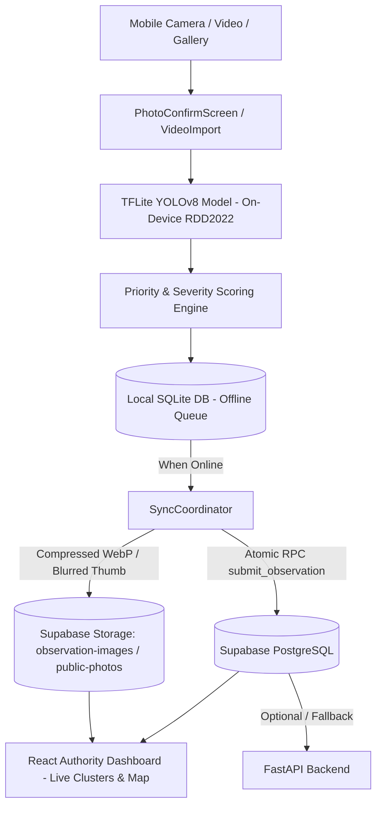

# TariqMap 🛣️

**Offline-First Intelligent Road Damage Inspection & Mapping Platform**

[](https://flutter.dev)
[](https://www.tensorflow.org/lite)
[](https://supabase.com)
[](https://fastapi.tiangolo.com)
[](https://flutter.dev)

TariqMap is a production-ready, offline-first mobile application and spatial analytics platform engineered for autonomous road anomaly detection, severity scoring, and infrastructure mapping. Designed to operate reliably in environments with intermittent or zero connectivity, TariqMap runs on-device computer vision models (YOLOv8) to detect potholes, cracks, and road degradation, automatically geolocates anomalies, and synchronizes with cloud storage and spatial databases once connectivity is restored.

---

## 🌟 Key Features & Innovations

### 1. 🤖 On-Device YOLOv8 Inference (100% Offline)
- **Active Model**: Bundled `road_damage.tflite` (RDD2022 4-class standard: D00, D10, D20, D40) calibrated for high-precision pothole and crack triage.
- **Experimental Models**: `road_damage_roadsense.tflite` is isolated as an experimental benchmark and disabled by default in production.
- **Zero Silent Mocks**: Physical Android and iOS devices run strictly on-device TFLite models with SHA-256 integrity verification. Mock mode is restricted to unsupported web browsers and visibly labeled.
- **Zero-Stutter Frame Processing**: Camera frames are processed via background Dart isolates (`compute`), bypassing UI-blocking loops.

### 2. 🏛️ Secure Organization & Authority Selection
- **Multi-Authority Support**: Direct assignment to responsible Tunisian road authorities:
  - **Municipality** (`MUNICIPALITY`) — Urban municipal roads.
  - **Ministry of Equipment** (`MINISTRY_OF_EQUIPMENT`) — National highways (RN), regional roads (RR), and local roads (RL).
  - **Tunisia Autoroutes** (`TUNISIA_AUTOROUTES`) — Toll highways (A1, A3, A4).
- **Persistent Selection**: First-launch onboarding setup screen with persistence in `SharedPreferences`, changeable at any time from Settings or Home header.
- **Zero Manual UUIDs**: Only verified organizations from database/canonical catalog are selectable.

### 3. 🔄 Atomic Observation Sync & Server-Side Validation
- **Atomic `submit_observation` RPC**: Database transactions ingest observation, location, agent runs, detections, and sync receipts atomically in a single round-trip.
- **Server-Side Validation**: Enforces coordinate bounds (GRCh/WGS84 lat [-90, 90], lng [-180, 180]), GPS accuracy limits (<= 100m), priority score bounds [0, 100], valid RDD2022 class codes, and model bundle version whitelisting.
- **Two-Phase Media Upload**: Explicit state progression (`pending` -> `uploading` -> `uploaded` / `failed`) with automatic crash recovery, preventing orphan storage objects and duplicate records.

### 4. 📹 Video Inspection with Incremental Persistence
- **Dual Scan Modes**:
  - **Fast Scan**: 5-second interval, up to 12 frames (quick corridor triage).
  - **Accurate Scan**: 2-second interval, up to 25 frames (dense inspection).
- **Live Diagnostics**: Real-time display of processed frames, active video timestamp, detection counter, and dynamic estimated time remaining.
- **Crash & Cancel Safety**: Each detected frame is saved incrementally to local SQLite storage immediately upon analysis; cancelling or interrupting preserves all completed defect observations.
- **Native FFmpeg Stitching**: Assembles detected frames and bounding box overlays into an annotated MP4 video with completion summary.

### 5. 🏛️ Ministry Road-Maintenance Command Center
- **Executive Overview**: 10 real-data KPI cards (active anomalies, critical locations, high-risk corridors, new reports, backlog age, overdue cases, in-progress repairs, completed repairs, mean resolution time, and estimated budget) with comparative delta indicators against prior periods.
- **Operations Action Center**: 8 dedicated work queues (`Critiques`, `En attente validation`, `En retard >14j`, `Non assignées`, `En cours`, `À vérifier`, `Répétés`, `GPS faible`) with operational data grid and safe bulk actions (status changes, priority adjustments, contractor assignments, and CSV exports).
- **GIS Operations Map**: Leaflet map with 20m DBSCAN spatial clustering, priority color-coding, multi-layer toggles (active anomalies, critical locations, clusters, national corridors, repaired locations), and RAG technical recommendations.
- **Road Segment Risk Matrix**: Deterministic corridor-level risk scoring ($0-100$) for Tunisian national routes (A1, A4, RN1, RN8, RN9, RR21, etc.) with transparent human-readable explanations and official DGPC unit-cost repair budgets.
- **Analytics & Trends**: Time series comparing new reports vs. certified repairs (backlog expansion/shrinkage), territorial backlog ranking across the 24 Tunisian governorates, and SLA performance benchmarks.
- **Data Quality & Model Telemetry**: Edge inference confidence calibration (high >80%, medium 50-80%, low <50%), class distribution, field GNSS precision integrity, and authority model feedback channels.
- **Standard Reports & Exports**: Filter-aware CSV with UTF-8 BOM for Microsoft Excel, native Excel TSV, standard GeoJSON `FeatureCollection` for QGIS/ArcGIS, and printable A4 work orders (Fiche de tournée d'intervention).
- **Audit Trail & Governance**: Chronological, immutable event log tracking all validations, assignments, status transitions, and repair verifications.

### 6. 🚗 Vehicle-Centered Drive Awareness Mode
- **Real-Time Road Hazard Warnings**: Alerts drivers to verified upcoming potholes and cracks directly ahead on their route.
- **Glanceable Passive HUD**: High-contrast, non-distracting vehicle-centered map with Heading-Up/North-Up toggle, large defect cards, and clear road ahead states.
- **Forward-Cone Route Matching**: Prioritizes hazards in the vehicle's driving direction ($\pm 35^\circ$ forward cone up to 300m) while filtering defects behind or on adjacent cross streets.
- **Multi-Tier Cooldown Alerts**: Gentle audio and haptic feedback on approaching hazards (warning at ~180m, urgent at ~60m) with 40-second anti-spam cooldown protection.
- **Offline SQLite Caching**: Automatically caches hazards in `cached_anomalies` table so warnings continue without disruption in remote or low-connectivity areas.
- **Privacy & Safety First**: Zero continuous path logging, zero continuous YOLO inference while driving, and mandatory initial driver safety agreement.

---

## 🏛️ System Architecture



### Repository Structure

```
TariqMap/
├── app/                              # Flutter Mobile Application
│   ├── android/                      # Android native configuration
│   ├── ios/                          # iOS native configuration
│   └── lib/
│       ├── core/                     # AppColors, ModelConfig, constants, Supabase config
│       ├── data/                     # Remote API clients (atomic RPC), local SQLite database
│       ├── inference/                # TFLite runner, NMS, coordinate normalization, letterboxing
│       ├── models/                   # Observation, Detection, Organization models
│       ├── screens/                  # HomeScreen, PhotoConfirm, VideoImport, ResultScreen, Settings, etc.
│       ├── services/                 # DetectionService, OrganizationService, SQLite repository, Location
│       └── widgets/                  # DashboardMap, AnomalyMarkers, ClusterBottomSheet
├── dashboard/                        # React / Vite Authority Dashboard
│   ├── src/                          # Dashboard components, Leaflet map, analytics, RAG client
│   └── vite.config.js                # Chunk optimization & proxy setup
├── backend/                          # FastAPI Ingestion & Persistence Service
│   ├── main.py                       # API endpoints & health checks
│   ├── schemas.py                    # Pydantic models & validation
│   └── supabase_store.py             # Supabase database mapping & client
├── supabase/                         # Database migrations & RLS configuration
│   └── migrations/                   # SQL migration scripts (including 20261016_atomic_ingest_and_validation.sql)
├── training/                         # Model training, dataset auditing & TFLite export
└── docs/                             # Architecture, hackathon demo, and ML evaluation docs
```

---

## 🚀 Getting Started

### 1. Mobile Application (Flutter)

#### Prerequisites
- Flutter SDK `>= 3.4.0 < 4.0.0`
- Android Studio / Xcode with platform tools
- Physical Android or iOS device (recommended for camera and TFLite acceleration)

#### Installation & Run
```bash
# Navigate to the app directory
cd app

# Install dependencies
flutter pub get

# Run unit tests
flutter test test/unit/

# Run on connected device
flutter run
```

---

### 2. Supabase Setup & Migrations

TariqMap uses Supabase PostgreSQL, Storage, and Row-Level Security:

1. Create a Supabase project at [supabase.com](https://supabase.com).
2. Execute the migration scripts located in `supabase/migrations/` in order:
   - `20260928183500_align_rdd_model.sql`
   - `20260928183800_allow_unauthenticated_observation_ingest.sql`
   - `20260929_add_media.sql`
   - `20260929_add_anon_rls_policies.sql`
   - `20261011164600_add_anomaly_type.sql`
   - `20261016_atomic_ingest_and_validation.sql` (Atomic `submit_observation` RPC, organizations seeding, and bounds check)
3. Ensure storage buckets `observation-images` (private) and `public-photos` (public thumbnails) exist.
4. Configure project credentials in [app/lib/core/supabase_config.dart](app/lib/core/supabase_config.dart).

---

### 3. Authority Dashboard (React / Vite)

```bash
# Navigate to the dashboard directory
cd dashboard

# Install dependencies
npm install

# Run tests
npm test -- --run

# Build production bundle
npm run build

# Start development server
npm run dev
```

---

## 📊 Road Damage Classification (RDD2022)

TariqMap classifies anomalies according to the international Road Damage Detection benchmark:

| Class Code | Defect Type | Severity Weight | Description |
|---|---|---|---|
| **D00** | Longitudinal Crack | Medium | Cracks running parallel to the direction of travel |
| **D10** | Transverse Crack | Medium | Cracks running perpendicular to the road axis |
| **D20** | Alligator Crack | High | Interconnected fatigue cracking indicating structural sub-base failure |
| **D40** | Pothole | Critical | Bowl-shaped road surface depressions requiring immediate repair |

---

## 👥 Authors & Contributors

- **Trabelsi Mohamed Amin** ([@TrabelsiAmin](https://github.com/TrabelsiAmin))
- **TariqMap Engineering Team**
