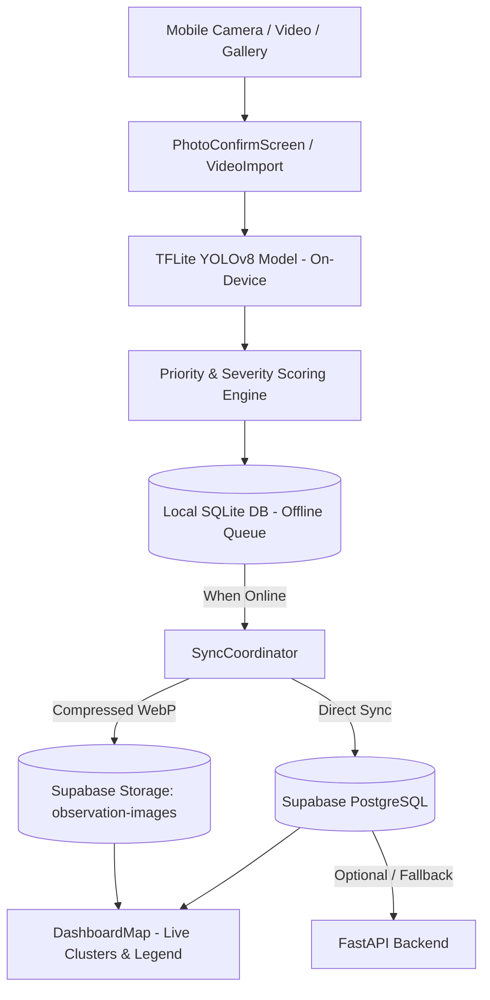

# TariqMap 🛣️

**Offline-First Intelligent Road Damage Inspection & Mapping Platform**

[](https://flutter.dev)
[](https://www.tensorflow.org/lite)
[](https://supabase.com)
[](https://fastapi.tiangolo.com)
[](https://flutter.dev)

TariqMap is a production-ready, offline-first mobile application and spatial analytics platform engineered for autonomous road anomaly detection, severity scoring, and infrastructure mapping. Designed to operate reliably in environments with intermittent or zero connectivity, TariqMap runs on-device computer vision models (YOLOv8) to detect potholes, cracks, and road degradation in real time, automatically geolocates anomalies, and synchronizes with cloud storage and spatial databases once connectivity is restored.

---

## 🌟 Key Features & Innovations

### 1. 🤖 On-Device YOLOv8 Inference (100% Offline)
- **TFLite Float32 Pipeline**: Runs the trained `oracl4/RoadDamageDetection` model locally on the mobile device. Zero cloud dependency during capture or inspection.
- **RDD2022 Standard Classes**: Detects longitudinal cracks, transverse cracks, alligator cracks, and potholes with confidence scoring and normalized bounding boxes.
- **Zero-Stutter Frame Processing**: Camera frames are processed via background Dart isolates (`compute`), bypassing UI-blocking JPEG encode/decode loops.
- **Robust Model Diagnostics**: Built-in tensor shape verification, normalized coordinate mapping, and transparent UI indicators for AI status (`TFLite AI ACTIVE` vs `DEMO MODE`).

### 2. 🗺️ Interactive Live Anomaly Map Dashboard
- **Geospatial Clustering**: Visualizes road damage observations directly on an interactive map (`flutter_map`) with dynamic clustering (~11m proximity grouping).
- **Severity & Class Color Coding**: Map markers are color-coded based on the dominant detected defect (Pothole, Alligator Crack, Longitudinal Crack, Transverse Crack) with fallback to severity priority score.
- **Live User Location**: Real-time GPS location tracking with an animated pulsating blue marker and one-tap re-centering.
- **Color Legend Overlay**: Instant visual guide to assess road network health at a glance.
- **Inspection Detail Bottom Sheet**: Tap any marker or cluster to inspect observation records, severity scores, timestamps, and high-resolution defect imagery loaded directly from Supabase Storage.

### 3. 📸 Streamlined Inspection Workflows
- **Take Photo Flow**: Fast single-defect capture with instant GPS coordinate locking and a dedicated confirmation screen (`PhotoConfirmScreen`) before running inference.
- **Record Video & Video Import**: Multi-frame anomaly extraction with temporal smoothing, deduplication, and stitched video generation powered by FFmpeg.
- **Gallery Import**: Analyze historical or externally captured road images with identical on-device detection precision.

### 4. 🗜️ Smart WebP Image Compression
- **Automatic Storage Optimization**: Converts captured anomaly photos to WebP format at 75% quality before syncing.
- **40–60% Bandwidth & Storage Reduction**: Reduces network payload and database storage costs without compromising inspection clarity.
- **Metadata Sanitization**: Automatically strips redundant EXIF tags while preserving exact GPS coordinates in the relational database.

### 5. ☁️ Direct Cloud Sync & Resilient Offline Queue
- **Direct Supabase Integration**: Mobile client pushes observations, coordinates, and media directly to Supabase Database & Storage via `supabase_flutter`.
- **Fault-Tolerant Sync Engine**: Observations are persisted locally in SQLite (`SqliteObservationRepository`) with versioned migrations. The background `SyncCoordinator` retries failed uploads with exponential backoff and idempotency keys.
- **RLS-Aware Ingestion**: Gracefully handles Row-Level Security policies to ensure observation and spatial data integrity.
- **Storage as Source of Truth**: Images are loaded as raw decoded bytes (`Uint8List`) from Supabase Storage with public URL fallbacks, guaranteeing reliable rendering across public and private buckets.

### 6. 🎨 Modern Dark-Mode UI/UX
- **Custom Design System**: Premium navy and teal palette (`AppColors`), smooth spring animations, tactile action buttons, and responsive sliver headers.
- **Settings & Config**: Configurable API endpoints and Supabase parameters directly within the app for physical device field testing.

---

## 🏛️ System Architecture



### Repository Structure

```
TariqMap/
├── app/                              # Flutter Mobile Application
│   ├── android/                      # Android native configuration
│   ├── ios/                          # iOS native configuration
│   └── lib/
│       ├── core/                     # AppColors, theme, constants, Supabase config
│       ├── data/                     # Remote API clients, Supabase service
│       ├── inference/                # TFLite model runner, coordinate normalization, smoothing
│       ├── models/                   # Observation, Detection, BoundingBox models
│       ├── screens/                  # HomeScreen, PhotoConfirm, VideoImport, ResultScreen, etc.
│       ├── services/                 # Detection, SQLite repository, ImageCompressor, Location
│       └── widgets/                  # DashboardMap, AnomalyMarkers, ClusterBottomSheet
├── backend/                          # FastAPI Ingestion & Persistence Service
│   ├── main.py                       # API endpoints & health checks
│   ├── schemas.py                    # Pydantic models & validation
│   ├── supabase_store.py             # Supabase database mapping & client
│   └── requirements.txt              # Python dependencies
├── supabase/                         # Database migrations & RLS configuration
│   └── migrations/                   # SQL migration scripts for schema & media storage
├── training/                         # Model training, dataset auditing & TFLite export
└── docs/                             # Architecture, hackathon demo, and ML evaluation docs
```

---

## 🚀 Getting Started

### 1. Mobile Application (Flutter)

#### Prerequisites
- Flutter SDK `>= 3.4.0 < 4.0.0`
- Android Studio / Xcode with platform tools
- Physical Android or iOS device (recommended for camera and TFLite acceleration)

#### Installation & Run
```bash
# Navigate to the app directory
cd app

# Install dependencies
flutter pub get

# Run on connected device
flutter run
```

> **Note on Web**: Flutter Web uses a simulated demo mode since native TFLite acceleration requires Android or iOS hardware binaries.

---

### 2. Supabase Setup

TariqMap uses Supabase for database persistence and image storage:

1. Create a Supabase project at [supabase.com](https://supabase.com).
2. Execute the migration scripts located in `supabase/migrations/` in your SQL Editor:
   - `20260928183500_align_rdd_model.sql`
   - `20260928183800_allow_unauthenticated_observation_ingest.sql`
   - `20260929_add_media.sql`
   - `20260929_add_anon_rls_policies.sql`
   - `20261011164600_add_anomaly_type.sql`
3. Create a Supabase Storage bucket named `observation-images`.
4. Configure your project credentials in [app/lib/core/supabase_config.dart](app/lib/core/supabase_config.dart).

---

### 3. FastAPI Backend (Optional Ingestion Service)

The mobile application connects directly to Supabase. An optional FastAPI server is included for server-side ONNX inference, proxy ingestion, or external system integrations.

```bash
# Navigate to the backend directory
cd backend

# Install dependencies
pip install -r requirements.txt

# Configure environment variables
cp .env.example .env
# Edit .env with your TARIQMAP_SUPABASE_URL and TARIQMAP_SUPABASE_SERVICE_ROLE_KEY

# Run server
uvicorn main:app --host 0.0.0.0 --port 8000 --reload
```

---

## 📊 Road Damage Classification (RDD2022)

TariqMap classifies anomalies according to the international Road Damage Detection benchmark:

| Class Code | Defect Type | Severity Weight | Description |
|---|---|---|---|
| **D00** | Longitudinal Crack | Medium | Cracks running parallel to the direction of travel |
| **D10** | Transverse Crack | Medium | Cracks running perpendicular to the road axis |
| **D20** | Alligator Crack | High | Interconnected fatigue cracking indicating structural sub-base failure |
| **D40** | Pothole | Critical | Bowl-shaped road surface depressions requiring immediate repair |

---

## 📚 Documentation & Further Reading

- [docs/hackathon-demo.md](docs/hackathon-demo.md) — Step-by-step demonstration walkthrough for live presentations.
- [docs/architecture.md](docs/architecture.md) — Detailed technical architecture and data flow diagrams.
- [docs/offline-sync.md](docs/offline-sync.md) — Deep dive into the SQLite queue, idempotency keys, and sync coordinator.
- [docs/dataset-audit.md](docs/dataset-audit.md) — Dataset audit, ethical AI considerations, and training pipeline methodology.
- [docs/backend-contract.md](docs/backend-contract.md) — Schema definitions and API specifications.

---

## 👥 Authors & Contributors

- **Trabelsi Mohamed Amin** ([@TrabelsiAmin](https://github.com/TrabelsiAmin))
- **TariqMap Development Team**
