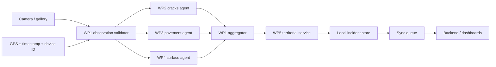
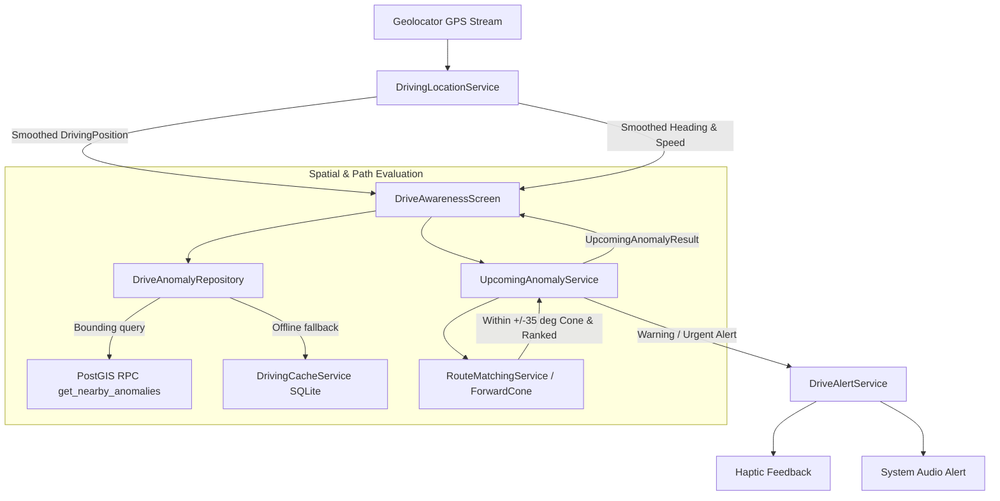

# TariqMap Hybrid Architecture

## Decision

Use Flutter for the phone application and Python for model preparation. The phone must work without network access during inspection. Network synchronization is a separate concern and must never block capture or inference.

## Runtime pipeline



The three agent calls run independently. If one model fails, the observation is retained with the successful outputs and an explicit agent error. No silent failure is allowed.

## Model bundles

Each model is packaged with a manifest:

```json
{
  "bundleVersion": "2026.09.0",
  "agent": "cracks",
  "format": "onnx",
  "inputSize": 640,
  "classes": ["D00", "D10"],
  "normalization": "0..1 RGB",
  "nmsIou": 0.45,
  "confidence": 0.35
}
```

The production bundle should contain the model, manifest, checksum, and model card. Prefer an int8 quantized student model after accuracy verification. Keep a float16 fallback for devices where int8 delegates are unavailable.

## Metadata and privacy

Capture metadata is not expected from RDD2024. WP1 creates it at runtime. GPS permission is requested only when the user starts an inspection. Images remain in app-private storage until the user or a synchronization policy uploads them. Do not infer exact physical depth from a 2D image.

## Priority

The client uses a transparent baseline score for triage only. A future backend may refine it using road class, confidence, defect severity, recurrence, and proximity to critical assets. The score is not an automatic decision and must remain editable or reviewable by the responsible actor.

## Backend boundary

The future backend should expose:

- `POST /observations` for batched observations and detections.
- `GET /roads/match?lat=&lon=` for route, segment, and owner.
- `PATCH /incidents/{id}` for status and intervention updates.
- `GET /analytics` for actor-specific aggregates.

The client currently uses a local territorial service so that the product flow is testable before the SIG data source is selected.


---

## Drive Awareness Subsystem Architecture

The Drive Awareness subsystem provides real-time, passive, glanceable driver alerts for verified and reported road anomalies ahead of the vehicle along its driving path.

### Architectural Principles
1. **Passive Safety First**: Strictly glanceable UI with high contrast, large typography, audio chimes, and haptic warnings. Prohibits deep interactions or keyboard input while driving.
2. **Zero Continuous Model Inference**: Does NOT run on-device YOLO models continuously while driving, protecting battery and preventing device overheating.
3. **Strict Privacy**: Does NOT upload continuous GPS breadcrumbs or tracking paths to remote servers. GPS queries are read-only and local to the active screen.
4. **Offline Resilience**: Automatically caches known hazards locally in SQLite (`cached_anomalies`), providing full warning capabilities without cell coverage.

### Component Diagram



### Components
- **`DrivingLocationService`**: Manages the continuous GPS location stream (5m distance filter), smooths heading via exponential moving average across the 0/360 boundary, computes movement bearings when speed $\ge 1.2$ m/s, and preserves heading when stationary.
- **`RouteMatchingService`**: Abstraction defining route and path relevance. Implemented via `ForwardConeRouteMatcher` ($\pm 35^\circ$ forward field of view, lookahead up to 400m, severity weighting). Easily extensible for future OSRM/Valhalla map matching.
- **`UpcomingAnomalyService`**: Selects the single highest-priority upcoming anomaly ahead, filters passed anomalies, enforces GPS accuracy thresholds, and returns formatted distance and advice.
- **`DriveAlertService`**: Controls gentle audio/haptic alert emission with anti-spam cooldown timers (30-40s) and multi-tier escalation (warning at ~180m, urgent at ~60m).
- **`DrivingCacheService`**: Manages offline SQLite caching in `cached_anomalies` table with spatial bounding box queries and TTL eviction.
