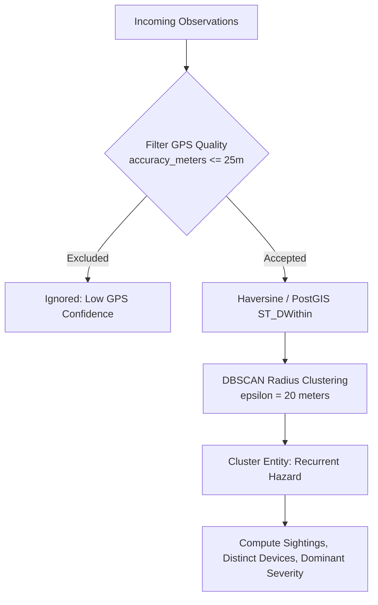

# Spatial Clustering: PostGIS Distance vs. Fixed Coordinate Grids

## 1. Why Fixed Coordinate Grids Fail for Decision Support

The mobile in-app map currently groups points by rounding coordinates to 4 decimal places (`gridKey = '${lat.toStringAsFixed(4)}_${lng.toStringAsFixed(4)}'`). While lightweight for quick on-device rendering, this approach is mathematically flawed for municipal decision support:

1. **Cell-Border Boundary Splits**:
   Two observations of the *exact same physical pothole* positioned 1.5 meters apart will be artificially split into two separate municipal work orders if they happen to lie across a coordinate boundary (e.g., latitude `36.80649` vs `36.80650`).
2. **GPS Jitter vs. Cell Dimension**:
   Typical smartphone GPS accuracy (`accuracy_meters`) under urban conditions ranges from $\pm 5\text{ m}$ to $\pm 15\text{ m}$. A 4-decimal grid cell at Tunisian latitudes ($\approx 36.8^\circ\text{ N}$) is approximately $11.1\text{ m} \times 8.9\text{ m}$. Because the measurement error is of the same magnitude as the cell size, repeated passes over a single hazard naturally bounce across 2 to 4 adjacent cells.
3. **Distortion with Latitude**:
   Grid degrees are non-isotropic: $0.0001^\circ$ of longitude spans $\approx 11.1\text{ m}$ at the equator, but shrinks to $\approx 8.9\text{ m}$ in Tunis ($11.1 \cdot \cos(36.8^\circ)$).

---

## 2. Institutional Distance-Based Clustering Architecture

The Authority Dashboard, Priority Scoring v2, and Repair Verification engine employ **real metric distance clustering**:



### Algorithm Specification:
1. **GPS Accuracy Threshold**:
   Exclude any observation where `accuracy_meters > 25.0` meters to prevent wild multipath drift from corrupting cluster centroids.
2. **Cluster Radius ($\epsilon = 20\text{ m}$)**:
   Observations within $20$ meters of each other belong to the same road defect cluster.
3. **Database Acceleration**:
   On the Supabase / PostgreSQL backend, spatial clustering utilizes the `locations.geog` PostGIS column:
   ```sql
   -- Distance-based grouping using PostGIS
   SELECT ST_ClusterDBSCAN(geog, eps := 20, minpoints := 1) OVER () AS cluster_id,
          observation_id, latitude, longitude
   FROM public.locations
   WHERE accuracy_meters <= 25;
   ```
4. **Client-side Fallback**:
   In the static dashboard, an optimized Haversine clustering pass groups fetched points within $20\text{ m}$, aggregating:
   - Total sighting count
   - Distinct confirming devices
   - First detected date vs. latest confirmed date
   - Worst defect class & max confidence
